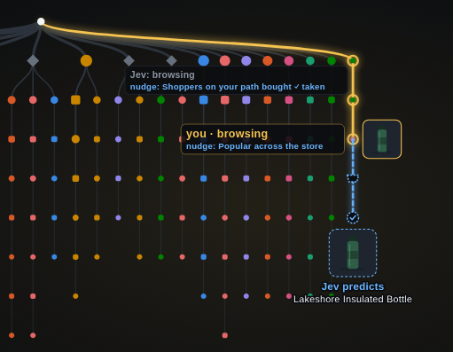

# Shop Trie

A demo storefront where every shopper's path is recorded in a prefix tree (a trie),
and **Jev** reads each shopper's intent and predicts what
they'll buy by matching their visit against the routes other shoppers took to a purchase.



*The share card (`/share`): my path through the store in gold, Jev's read of me and the
nudge it showed at each step, and the dashed route to the purchase Jev predicts.*

## What it does

- **A 100-product store.** "Northwoods Outfitters" has 8 categories (Footwear,
  Outerwear, Fleece & Sweaters, Shirts & Tees, Packs & Bags, Camp & Hike, Home &
  Blankets, Accessories). Product names and illustrations are made up. Every **price,
  star rating and review count comes from a real item** in the
  [Amazon Reviews 2023](https://huggingface.co/datasets/McAuley-Lab/Amazon-Reviews-2023)
  dataset (McAuley Lab, UCSD).
- **A trie of every visit.** Each step is a page type (home, a search topic, a category
  listing, a product page, the cart, bought). Each node counts the visits that started
  that way, where they went next, how they ended (bought or left) and what they bought.
- **Simulated shoppers.** One click adds 100 or 10,000 realistic visits: about 3.5% buy,
  a quarter leave after one page, and products are chosen in proportion to their real
  review counts.
- **Jev on every click** (from the second page on), with two calls side by side:
  1. **Reads your mindset:** decisive, comparing, browsing, gift hunting, deal hunting,
     or about to leave. Jev sees your pages, your cart and what the crowd did from your
     position in the trie. The mindset decides which nudges (suggestion strips) the
     store shows.
  2. **Predicts your purchase:** Jev scores how closely each recorded purchase journey
     matches your visit so far, from *different* to *same way*. The closest journeys
     vote for the product they ended in, weighted by how many shoppers took them.
- **Ask in plain language.** "A warm gift for my dad who ice fishes, under $80": Jev
  scores the purchase routes from where you are and shows the product and route that
  fit best.

The split: **the trie remembers what everyone did; Jev judges which of it applies to you.**

## Run it

```bash
python -m venv .venv
.venv/bin/pip install -r requirements.txt
cp .env.example .env                        # then set TYPESAFE_API_KEY in .env
.venv/bin/uvicorn store:app --reload
```

Then open http://localhost:8000:

1. Click **+10K shoppers** to grow the trie.
2. Browse a few pages: a listing, a product, back to the listing, another product.
   Click a product in one of the suggestion strips to take a nudge.
3. Optionally ask a question in the box at the top.
4. Open **http://localhost:8000/share** for the 1200×627 share card. To save it as an
   image, use Chrome DevTools: right-click the `.card` element and choose
   *Capture node screenshot*.

The share card is drawn from your own session, so take the screenshot in the browser
you shopped in.

## Pages and endpoints

| Path | What it is |
|---|---|
| `GET /` | The store: stats, the question box, the storefront, Jev's nudges and the live trie |
| `GET /share` | The share card: the trie alone, with your path, Jev's reads and nudges, and the predicted purchase |
| `GET /users` | Every active shopper's position, as JSON |
| `GET /users/{id}` | One shopper: steps, cart, mindset, odds of buying, likely purchase, Jev's prediction, last question |
| `GET /trie.svg` | The trie drawing (the main page refreshes it every 3 seconds) |
| `POST /go`, `/ask`, `/leave`, `/simulate`, `/clear` | Take a step, ask a question, end the visit, add shoppers, empty the trie |

Your user ID is linked in the main page's footer.

## Files

| File | What it holds |
|---|---|
| `store.py` | The app: trie, simulator, Jev calls, JSON-to-HTML rendering, routes |
| `store_art.py` | The product illustrations: 19 product types, drawn as SVG in each product's color |
| `store/catalog.json` | The 100 products |
| `store/build_catalog.py` | Rebuilds the catalog from the Amazon dataset (downloads about 360 MB of samples into `store/.cache/` the first time) |
| `store/page.json`, `store/share.json` | The page layouts, as JSON nodes the renderer turns into HTML |
| `store/modules/*.json` | The suggestion strips (nudges) |
| `store/trie.json` | The saved trie, written on every change (not committed; **Clear** deletes it) |

## The trie

A depth-bounded prefix trie with counts and outcome annotations. Every visit is
inserted from the root, so each node is one exact *start* of a visit, and visits that
start the same way share nodes. The symbols are 23 page types, and only the first 10
steps of a visit are kept. Finding your node takes one dictionary lookup per step.

When your exact path is rare, predictions fall back to the longest start of your visit
with enough data, and the page says which ("your first 2 steps").

Settings are constants at the top of `store.py`, including `DEPTH` (steps kept),
`MIN_ODDS` (finished visits needed before quoting a purchase rate) and `MAX_ROUTES`
(journeys Jev scores per call).

## Limitations

- **Simulated data.** The shoppers come from a simulator, so the trie reflects the
  simulator's assumptions until real traffic replaces them.
- **Thin evidence deep in long visits.** At 10K visits there are only about 300
  purchases, so predictions for long, unusual paths may rest on a handful of shoppers.
  The prediction card shows its support.
- **Single process.** Sessions live in memory and the trie file is rewritten on every
  click. Fine for a demo, not for several server processes.
- **Latency.** The two Jev calls per click take about 0.5 s together.

## Credits

Prices, ratings and review counts come from Amazon Reviews 2023 (Hou et al., McAuley
Lab, UCSD). Store and product names, descriptions and artwork are fictional.
